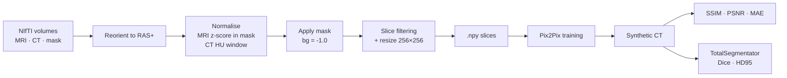

# 🧠 Synthetic CT Generation from MRI with Pix2Pix

Deep-learning pipeline that generates a **synthetic CT (sCT)** from a brain **MRI** using a conditional GAN (Pix2Pix), together with a full preprocessing, training and clinical-evaluation framework (SSIM / PSNR / MAE / Dice / HD95).


*2nd-semester end project, RV College of Engineering.*

<!-- Add a results figure (MRI | real CT | synthetic CT):

-->

---

## 📑 Table of Contents
- [Motivation](#-motivation)
- [Highlights](#-highlights)
- [Dataset](#-dataset)
- [Pipeline](#-pipeline)
- [Model](#-model)
- [Getting Started](#-getting-started)
- [Results](#-results)
- [Training Stability: Lessons Learned](#-training-stability-lessons-learned)
- [Bonus: 3D Visualisation](#-bonus-3d-visualisation)
- [Project Structure](#-project-structure)
- [Team & Acknowledgements](#-team--acknowledgements)

---

## 🏥 Motivation

Radiotherapy planning normally needs **both** an MRI (soft-tissue tumour delineation) and a CT (Hounsfield-unit-based dose calculation). That means extra ionising radiation, higher cost, longer planning, and 1–3 mm co-registration error between the two scans. Generating a CT directly from the MRI could remove the physical CT scan entirely.

## ✨ Highlights

- Pix2Pix conditional GAN with a rebuilt **7-level U-Net** generator and **70×70 PatchGAN** discriminator
- Leak-free preprocessing → **27,883 paired 256×256 slices**
- Stabilised GAN training (discriminator warmup, asymmetric updates, label smoothing, gradient clipping)
- Mixed-precision training on an NVIDIA A100 (bfloat16)
- Two-track evaluation: pixel metrics **and** clinical segmentation metrics via TotalSegmentator
- Evaluation framework reused by teammates for CycleGAN and diffusion comparisons

## 📦 Dataset

[**SynthRAD2023**](https://zenodo.org/records/7260705) (Grand Challenge, Zenodo record 7260705), brain subset: paired T1-weighted MRI, CT and brain mask NIfTI volumes from three Dutch academic medical centres.

| Split | Contents | Used for |
|---|---|---|
| `Task1` | MRI + CT + mask | Training and quantitative metrics |
| `Task1_val` | MRI + mask only (no CT) | Qualitative inference only |

> The data is **not** included in this repository. Download it from Zenodo and respect the dataset's licence and terms.

## 🔄 Pipeline



### Preprocessing details
1. **Reorientation:** `nibabel.as_closest_canonical` (RAS+) so the slice axis is consistent across scanners.
2. **MRI normalisation:** z-score using only voxels inside the brain mask, clipped to ±3σ, scaled to `[-1, 1]`.
3. **CT normalisation:** clipped to HU window `[-1000, 2000]`, scaled linearly to `[-1, 1]`.
4. **Masking:** applied **after** normalisation; background explicitly set to `-1.0`.
5. **Slice filtering:** drop slices with < 15,000 foreground mask pixels, a flat CT range (< 0.5 after normalisation), or < 15% tissue coverage.
6. **Resize:** 256×256, bilinear (OpenCV).

## 🏛️ Model

**Generator:** U-Net with 7 encoder levels, bottleneck, 7 decoder levels, skip connections at every level, dropout (p = 0.5) on the first 3 decoder blocks, and tanh output. The decoder uses **bilinear upsample + Conv2d** instead of transposed convolutions (this removed checkerboard artefacts).

**Discriminator:** 4-layer 70×70 **PatchGAN**, 2-channel input (MRI + candidate CT), output `(B, 1, 30, 30)`.

**Loss:**

$$\mathcal{L}_G = \mathcal{L}_{GAN} + \lambda_{L1}\mathcal{L}_{L1} + \lambda_{SSIM}\mathcal{L}_{SSIM},\qquad \lambda_{L1}=100,\ \lambda_{SSIM}=10$$

**Training configuration**

| Setting | Value |
|---|---|
| Batch size | 16 (A100) |
| Optimiser | Adam (β₁ = 0.5, β₂ = 0.999) |
| Learning rates | G: 2e-4 · D: 1e-4 |
| Schedule | Cosine annealing |
| Discriminator warmup | 5–10 generator-only epochs |
| Precision | bfloat16 autocast (GradScaler disabled) |
| Gradient clipping | `max_norm=1.0` on G |
| Checkpoint selection | Early stopping on best validated epoch (≈ 43–45) |

## 🚀 Getting Started

### Requirements

```bash
pip install torch torchvision --index-url https://download.pytorch.org/whl/cu121
pip install pytorch-msssim nibabel numpy opencv-python scipy pandas matplotlib tqdm TotalSegmentator
```

A CUDA GPU is strongly recommended (developed on an RTX 3060 12 GB, then an A100 40 GB).

### Run

> Adjust script names/arguments to match your checkout.

```bash
# 1. Preprocess raw NIfTI volumes into 256×256 .npy slices
python scripts/preprocess.py

# 2. Train
python train.py

# 3. Generate plots (SSIM/PSNR/MAE histograms, boxplots, summary card)
python plot_results.py
```

For long jobs on a remote server, use `tmux` so a dropped SSH connection doesn't kill training:

```bash
tmux new -s train
python train.py        # detach: Ctrl+B then D · reattach: tmux attach -t train
```

## 📈 Results

Best checkpoint at **epoch 43–45**. SSIM plateaued from roughly epoch 25–30 onward.

### Pixel-level metrics

Computed against real CT on the **training** split, because `Task1_val` ships without ground-truth CT. These are not held-out numbers.

| Metric | Mean | Std | Min | Max |
|---|---|---|---|---|
| SSIM | 0.9030 | 0.0367 | 0.7454 | 0.9753 |
| PSNR (dB) | 28.28 | 2.504 | 16.881 | 35.004 |
| MAE (normalised) | 0.0134 | 0.0048 | 0.0046 | 0.0517 |

Both SSIM and PSNR fall within the published SynthRAD2023 benchmark range (SSIM 0.87–0.94, PSNR 28–32 dB).

### Clinical segmentation metrics (Dice / HD95)

The real CT and the synthetic CT (generated from the same patient's MRI) were both segmented with TotalSegmentator (`brain_structures` + `appendicular_bones`). Dice and 95th-percentile Hausdorff distance were then computed per structure.

| Metric | Value |
|---|---|
| Overall mean Dice (16 structures) | 0.5750 ± 0.1496 |
| Mean Dice, brainstem & cerebellum | 0.7487 ± 0.0574 |
| Mean HD95, brainstem & cerebellum | ~9.45 mm |
| Structures with Dice > 0.75 | 1 / 16 |
| Structures with Dice > 0.85 | 0 / 16 |

**Interpretation.** Pix2Pix is a strong pixel-level baseline, but it falls short of the clinical acceptability thresholds (Dice > 0.85, HD95 < 5 mm). The synthetic CT over-predicts bone-range intensities and under-predicts soft-tissue ones. This is a known tendency of L1-dominated GAN training, which regresses toward a plausible average instead of committing to precise boundaries. SSIM/PSNR and Dice/HD95 can disagree sharply, so both are reported.

## 🛡️ Training Stability: Lessons Learned

Discriminator dominance was the recurring failure mode: `loss_G_GAN` climbed from ~1 to 5–7 while `loss_D` collapsed toward 0, giving white-out or "melted" outputs. What helped, in order of introduction:

1. **Discriminator warmup**: generator-only L1 + SSIM training for the first 5–10 epochs
2. **Asymmetric updates**: D updated every 2nd/3rd batch, G updated twice per batch
3. **Label smoothing**: real label 0.9 instead of 1.0
4. **Gradient clipping** on G (`max_norm=1.0`) once mixed precision was introduced

The most stable run held `loss_D` at ~0.19–0.20 for 25 epochs while SSIM rose from 0.79 to over 0.90. Collapse still recurred intermittently later (e.g. epoch 44 in one run), which is why **early stopping at the best checkpoint** is standard practice here.

<details>
<summary><b>Other bugs found and fixed in the starting codebase</b></summary>

| Issue | Fix |
|---|---|
| Shallow U-Net (4 down / 3 up blocks, no bottleneck) | Rebuilt as a full 7-level U-Net with skip connections at every level |
| Checkerboard "holes" in output | `ConvTranspose2d` → `Upsample(bilinear)` + `Conv2d` |
| Double normalisation in `dataset.py` | Removed the redundant step; kept only a safety clip |
| Mask applied *before* normalisation (background ≠ −1) | Normalise first, then mask, with background set to −1.0 |
| Empty validation slices | Stricter `SLICE_THRESHOLD` and a `TISSUE_FRACTION` check |
| `Task1_val` has no CT but was loaded as if it did | Split into `process_case_train()` and `process_case_val()` |
| Broken PyTorch `2.11.0` on the server | Reinstalled a stable CUDA 12.1 build |
| NaN explosion (bfloat16 vs. float16 `GradScaler`) | Explicit `dtype=torch.bfloat16`, `GradScaler` disabled |
| SSH drop killed training | Run inside `tmux` |
</details>

## 🧊 Bonus: 3D Visualisation

`export_to_mat.py` and `view_synthetic_ct.m` stack synthetic slices into a volume and render an interactive cranial-bone isosurface in MATLAB, with a slice scroller and a live threshold slider. It was later shelved in favour of the more rigorous Dice/HD95 evaluation.

## 🗂️ Project Structure

```text
mrict/
├── checkpoints/          # epoch_N.pth
├── outputs/              # epoch_N.png sample grids
├── processed/            # processed/brain/train/{ct,mri}/*.npy
├── scripts/
│   ├── dataset.py
│   ├── models.py
│   ├── preprocess.py
│   └── utils.py
├── Task1/                # raw training volumes (not tracked)
├── Task1_val/            # raw validation volumes (not tracked)
├── train.py
├── plot_results.py
├── export_to_mat.py
└── view_synthetic_ct.m
```

## 🤝 Team & Acknowledgements

- **Pix2Pix baseline** (this repo): architecture and bug-fixing, preprocessing pipeline, training, evaluation framework (SSIM/PSNR/MAE/Dice/HD95), and 3D visualisation tooling.
- **CycleGAN and diffusion models:** trained by teammates on the same dataset, reusing this preprocessing and evaluation setup. Those results are outside the scope of this repository.
- Dataset: [SynthRAD2023 Grand Challenge](https://zenodo.org/records/7260705).
- Tools: [TotalSegmentator](https://github.com/wasserth/TotalSegmentator), [pytorch-msssim](https://github.com/VainF/pytorch-msssim), [nibabel](https://nipy.org/nibabel/).
- The initial training loop was adapted from a third-party Pix2Pix implementation; add the original repo link and licence here.

> ⚕️ **Research use only.** This project is not a medical device and has not been clinically validated.

## 📄 License

Add a license (e.g. MIT). If you adapted third-party code, make sure its licence is compatible and credited.
